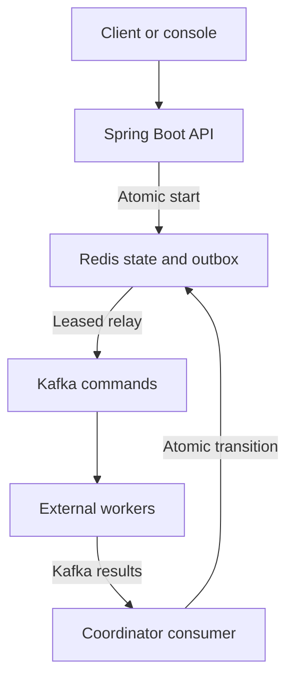

# Saga Harbor

**A small, inspectable checkout saga coordinator.** Java 21 · Spring Boot · Kafka · Redis · React/TypeScript.

Ledger Bridge reconciles two observed facts. Quota Forge admits work under a quota. Saga Harbor coordinates a multistep workflow and emits compensating commands when a downstream step fails. It is a reference implementation, not a payment service.

## Architecture



`RESERVE → CHARGE → COMPLETED` is the success path. Reservation failure ends in `FAILED`. Charge failure emits `RELEASE`, then ends in `COMPENSATED` or `MANUAL_REVIEW` if release fails. The coordinator never calls payment or inventory systems itself. Workers must implement those actions and make each `commandId` idempotent.

## Quick start

Requires Docker Engine with Compose v2, `openssl`, `curl`, and Python 3 for the smoke script.

```bash
export SAGA_API_KEY="$(openssl rand -hex 32)"
docker compose up --build -d
bash scripts/e2e.sh
```

Open http://localhost:8081 for the console. Enter the local API key; it stays in page memory. The API listens on localhost:8080. The smoke script creates an order, consumes command messages, publishes reserve success, charge failure, and release success, then asserts `COMPENSATED`. It is a demonstration worker, not a payment integration. Stop with `docker compose down`; use `-v` only to erase local Redis and Kafka data.

Start an independent saga:

```bash
curl -i http://localhost:8080/api/v1/sagas \
  -H "Authorization: Bearer $SAGA_API_KEY" \
  -H "Idempotency-Key: $(cat /proc/sys/kernel/random/uuid)" \
  -H 'Content-Type: application/json' \
  -d '{"orderId":"order-1001"}'
```

The response contains the saga UUID. Query it with `GET /api/v1/sagas/{uuid}` and the same bearer token. A returned state is coordinator state, not proof of a downstream effect.

The machine-readable HTTP contract is in [OpenAPI](docs/openapi.yaml). The Kafka result envelope is validated for exact JSON field types before it can change state.

## Contracts

The `POST /api/v1/sagas` body has one `orderId`: 1–128 ASCII letters, digits, `_ . : -` (without spaces). `Idempotency-Key` is a UUID. Retrying the same key and order returns the same saga ID (200); a different order with that key returns 409. Creation returns 201. Missing/invalid authorization returns 401 for valid requests; the key is required at startup and must be at least 24 characters. The API returns 503 when the bounded outbox is full. State and idempotency mappings are retained indefinitely in this reference implementation.

`saga.commands` contains JSON `{schemaVersion:1,eventId,sagaId,orderId,commandId,action}` keyed by `sagaId`. Actions are `RESERVE`, `CHARGE`, `RELEASE`. Workers publish JSON `{schemaVersion:1,sagaId,commandId,success}` to `saga.results`, also keyed by `sagaId`. `success` must be a JSON boolean; result values above 8 KiB are rejected. Unknown saga IDs and malformed envelopes go to `saga.results.dlt` before input offsets are acknowledged. Results with stale command IDs are ignored as duplicates; the current expected command ID is visible through the API. `createdAtMs` and `updatedAtMs` use Redis server time for operator age indicators. The three topics are created with three partitions in Compose.

## Consistency and failure model

- Lua scripts atomically update a saga and enqueue the next command in Redis. Concurrent duplicate results advance only once. Redis is the durable source of coordinator state; AOF is enabled locally, but a primary failure can still lose acknowledged writes.
- The relay leases an outbox entry for 30 seconds, waits for Kafka acknowledgement, then deletes it. A crash after Kafka acknowledgement can emit a duplicate on lease expiry. Consumers **must** deduplicate by `commandId`; each side effect needs its own idempotency store.
- A full outbox rejects creation or a transition that needs to emit a command without altering state. The Kafka consumer retries that record when capacity returns. Redis errors fail closed. There is no distributed transaction between Redis and Kafka.
- Transient consumer failures retry indefinitely at a fixed interval; a persistent failure blocks that partition and requires an operator response. Invalid envelopes are acknowledged only after the dead letter topic confirms receipt. Prometheus exposes outcome counters with bounded action/outcome labels.
- This implementation does not automatically time out uncertain payment or inventory outcomes. Late successes and compensations can create financial risk. Alert on aging sagas and use a documented manual decision process with downstream facts before recovery.
- Outbox count is bounded by `OUTBOX_CAPACITY` (default 10,000), while saga and idempotency records are not. Size Redis memory and implement a retention/archive process for real deployments. One Redis primary is assumed; these scripts touch multiple keys and are not Redis Cluster compatible.

See [operations](docs/OPERATIONS.md) and [security](SECURITY.md) before adapting this to live systems.

## Verification

```bash
mvn verify                  # Java 21, Maven 3.9+, Docker for Testcontainers
cd ui && npm ci && npm test && npm run build
```

`WorkflowIT` uses real Redis under Testcontainers to exercise idempotent creation under concurrency, normal and compensating transitions, concurrent duplicate results, outbox saturation, and lease reclaim. GitHub Actions also builds the images and drives Kafka through Compose with `scripts/e2e.sh`, covering compensation, stale replay, malformed-result dead letter, restart, and success. No capacity, cloud, or live worker claim is implied.

## Contributing and license

Focused bug reports and pull requests are welcome. Include a failing test for behavior changes. Do not include credentials or customer data in issues. MIT licensed; see [LICENSE](LICENSE).
